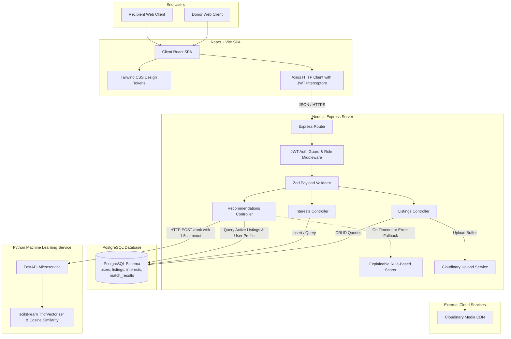
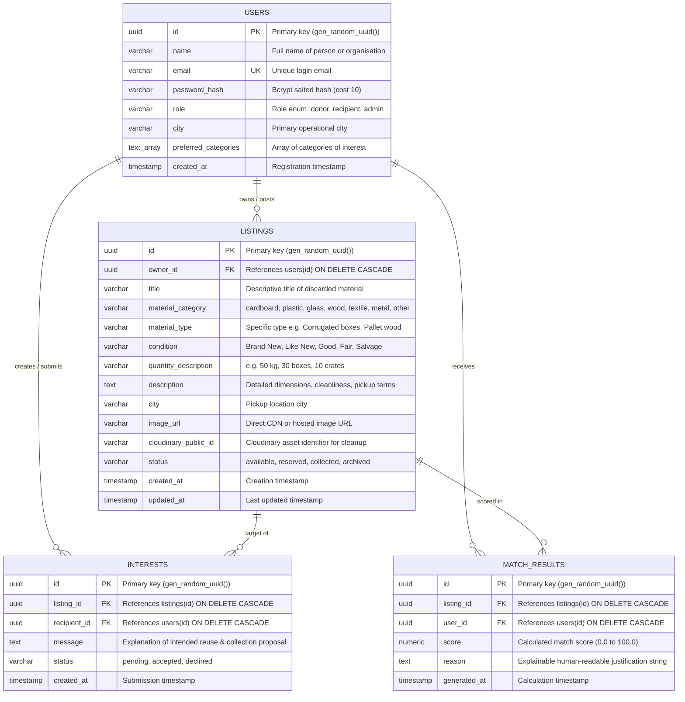
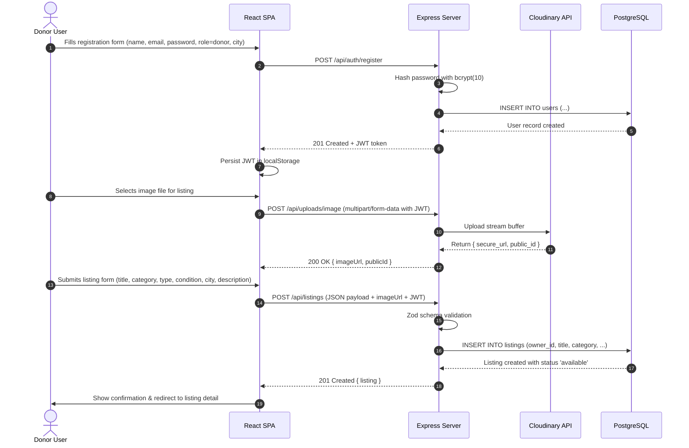
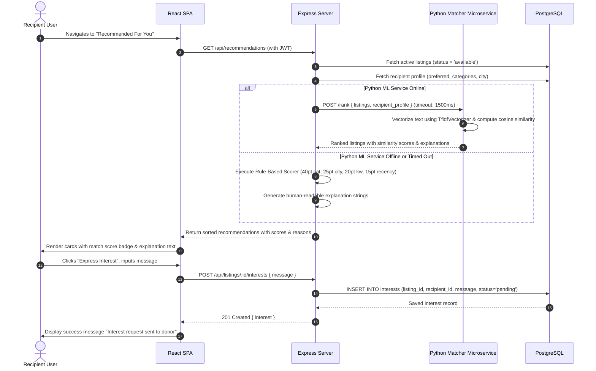

# ReSource AI — System Architecture Specification

---

## 1. Architectural Overview & Design Principles

ReSource AI follows a **modular multi-tier distributed architecture** composed of four decoupled subsystems:
1. **Client Tier (Presentation):** Single-page web application built with React.js, Vite, and Tailwind CSS.
2. **Application Tier (Business Logic):** RESTful API server built with Node.js and Express.js, implementing JWT security, input validation with Zod, and service orchestration.
3. **Data Tier (Persistence):** ACID-compliant PostgreSQL relational database with connection pooling, migrations, and declarative indexes.
4. **Intelligence Tier (Recommendation Service):** Dual-layer engine comprising an internal Node.js 100-point explainable rule-based scorer and an optional external Python microservice running scikit-learn (TF-IDF vectorizer + Cosine Similarity).

---

## 2. Entity Relationship (ER) Model

---

## 3. End-to-End Sequence Diagrams

### Sequence 1: Donor Registers, Uploads Photo, and Creates Listing

---

### Sequence 2: Recipient Browses, Explores Explainable Recommendations, and Expresses Interest

---

## 4. REST API Endpoint Specification

### Public Endpoints
* `GET /api/health`: Health probe returning system status, database latency, and timestamp.
* `POST /api/auth/register`: Create user account. Returns `{ token, user }`.
* `POST /api/auth/login`: Authenticate credentials. Returns `{ token, user }`.
* `GET /api/listings`: Paginated listing catalog with query filters:
  * `?category=cardboard`
  * `?city=Bengaluru`
  * `?condition=Good`
  * `?search=shipping+boxes`
  * `?page=1&limit=12`
* `GET /api/listings/:id`: Fetch single listing details with public donor metadata.

### Authenticated Endpoints (Requires `Authorization: Bearer <token>`)
* `GET /api/auth/me`: Get profile of authenticated user.
* `PATCH /api/users/me`: Update profile fields (`name`, `city`, `preferred_categories`).
* `POST /api/uploads/image`: Upload listing photo (multipart file `image`).
* `POST /api/listings`: Create new listing (must be `donor` or `admin`).
* `PATCH /api/listings/:id`: Update listing (must be listing owner or `admin`).
* `DELETE /api/listings/:id`: Archive/delete listing (must be listing owner or `admin`).
* `POST /api/listings/:id/interests`: Submit interest request with message.
* `GET /api/listings/:id/interests`: Retrieve interest requests for a specific listing (owner only).
* `GET /api/users/me/interests`: Retrieve interest requests sent or received by the user.
* `PATCH /api/interests/:id/status`: Update interest status (`accepted`, `declined`).
* `GET /api/recommendations`: Retrieve ranked listing recommendations with transparent explanations.

---

## 5. Scope Boundaries: MVP Scope vs. Non-Goals

| Feature Category | In Scope (MVP Release) | Non-Goals (Future Extensions) |
| :--- | :--- | :--- |
| **Monetary Transactions** | 100% Free / Direct Barter (no payment gateway) | Integrated escrow or marketplace payments |
| **Communication** | Structured Interest Request forms with status tracking | Live WebSocket instant chat / voice calls |
| **Location / Mapping** | City-level matching & textual address pickup details | Live GPS tracking, map route navigation, courier API |
| **Machine Learning** | Content-based TF-IDF + Cosine Similarity + Rule-based fallback | Deep neural networks, image vision models, collaborative filtering |
| **Platforms** | Fully responsive web app (mobile, tablet, desktop) | Native iOS/Android app store packages |

---

## 6. User Roles, User Stories, and Acceptance Gates

### Role 1: Material Donor
* **User Story:** "As a restaurant manager, I want to list clean 20-liter oil tins with photos so that an upcycling gardener or artisan can collect them."
* **Acceptance Gate:**
  * Listing is created with photo, quantity, city, and status `available`.
  * Listing is immediately visible in marketplace search and donor dashboard.
  * Donor receives interest requests from recipients and can mark the item as `reserved`.

### Role 2: Material Recipient
* **User Story:** "As an architecture student, I want to find free cardboard sheets in my city with a clear explanation of why they match my project."
* **Acceptance Gate:**
  * Recipient configures preferred categories (`cardboard`) and city (`Pune`).
  * System recommends matching listings with a visible badge ("Match Score: 95/100") and human-readable reason.
  * Recipient submits an interest message and receives confirmation.

### Role 3: Platform Administrator
* **User Story:** "As an administrator, I want to verify system health and archive fraudulent listings to maintain platform safety."
* **Acceptance Gate:**
  * Access protected admin overview.
  * View total registered users, active listings, and interest counts.
  * Archive or remove listings violating community guidelines.
