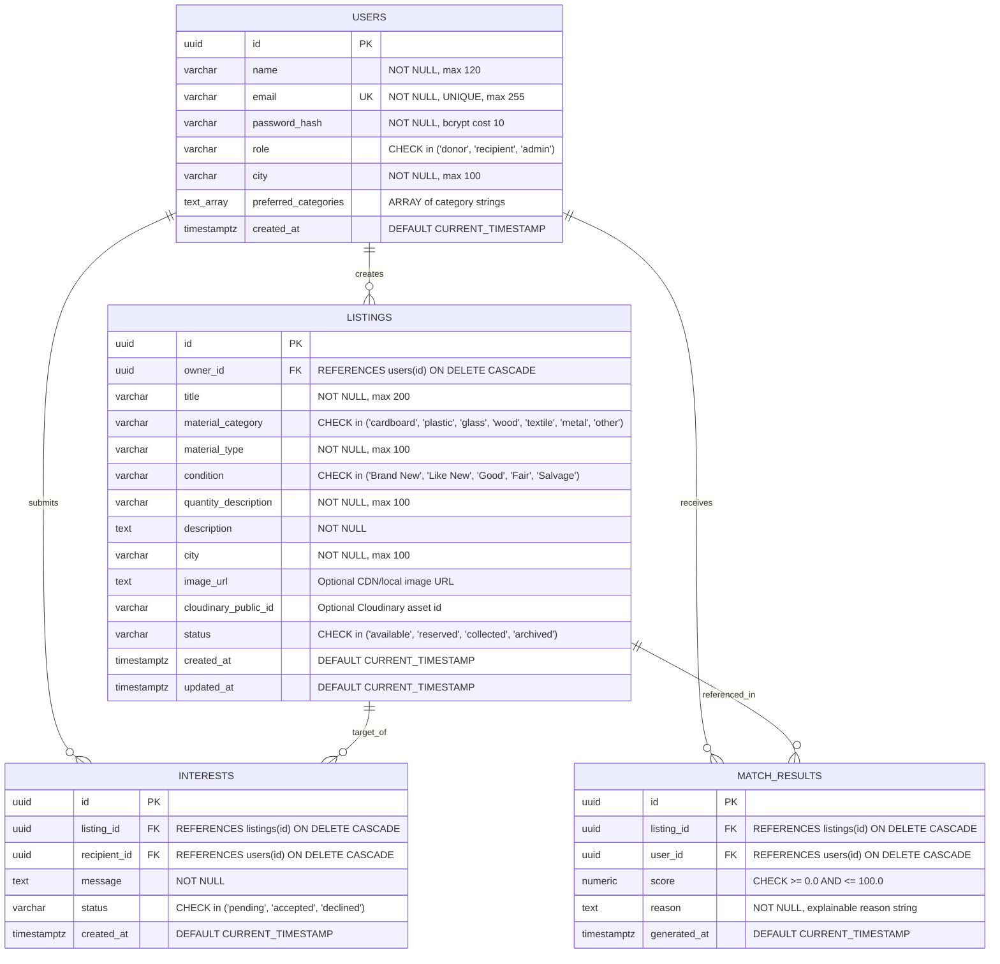

# ReSource AI — Database Architecture & Schema Specification

---

## 1. Overview & Engine Specification

* **Database Engine:** PostgreSQL (v14+)
* **Connection Layer:** `pg` (node-postgres) with connection pooling (`pg.Pool`)
* **Default Database Name:** `resource_ai`
* **Schema Integrity:** Strict Foreign Key constraints with `ON DELETE CASCADE`, composite checks, and optimized B-Tree indexes.
* **UUID Strategy:** Primary keys use Version 4 UUIDs generated via `gen_random_uuid()` (or `pgcrypto`).

---

## 2. Entity Relationship Diagram (ERD)



---

## 3. Data Dictionary

### Table: `users`
| Column | Type | Constraints | Description |
| :--- | :--- | :--- | :--- |
| `id` | `UUID` | `PRIMARY KEY DEFAULT gen_random_uuid()` | Unique user identifier |
| `name` | `VARCHAR(120)` | `NOT NULL` | Full name of individual or organization |
| `email` | `VARCHAR(255)` | `NOT NULL UNIQUE` | Login email address |
| `password_hash` | `VARCHAR(255)` | `NOT NULL` | 10-round bcrypt salted hash |
| `role` | `VARCHAR(20)` | `NOT NULL CHECK ('donor','recipient','admin')` | Access control role |
| `city` | `VARCHAR(100)` | `NOT NULL` | Base operational location |
| `preferred_categories`| `TEXT[]` | `DEFAULT '{}'` | Array of preferred waste categories |
| `created_at` | `TIMESTAMPTZ` | `DEFAULT CURRENT_TIMESTAMP` | Account creation timestamp |

### Table: `listings`
| Column | Type | Constraints | Description |
| :--- | :--- | :--- | :--- |
| `id` | `UUID` | `PRIMARY KEY DEFAULT gen_random_uuid()` | Unique listing identifier |
| `owner_id` | `UUID` | `NOT NULL FK -> users(id) ON DELETE CASCADE` | Creator of the listing |
| `title` | `VARCHAR(200)` | `NOT NULL` | Descriptive title |
| `material_category` | `VARCHAR(50)` | `NOT NULL CHECK (category in ...)` | Taxonomy category |
| `material_type` | `VARCHAR(100)` | `NOT NULL` | Specific subtype (e.g. Pine Pallet) |
| `condition` | `VARCHAR(50)` | `NOT NULL CHECK (condition in ...)` | Quality grade |
| `quantity_description`| `VARCHAR(100)`| `NOT NULL` | Human-readable quantity |
| `description` | `TEXT` | `NOT NULL` | Dimensions, pickup instructions |
| `city` | `VARCHAR(100)` | `NOT NULL` | Collection city |
| `image_url` | `TEXT` | `NULLABLE` | Image CDN URL |
| `cloudinary_public_id`| `VARCHAR(255)`| `NULLABLE` | Cloudinary asset reference |
| `status` | `VARCHAR(20)` | `NOT NULL CHECK ('available','reserved',...)` | Lifecycle status |
| `created_at` | `TIMESTAMPTZ` | `DEFAULT CURRENT_TIMESTAMP` | Creation timestamp |
| `updated_at` | `TIMESTAMPTZ` | `DEFAULT CURRENT_TIMESTAMP` | Last updated timestamp |

### Table: `interests`
| Column | Type | Constraints | Description |
| :--- | :--- | :--- | :--- |
| `id` | `UUID` | `PRIMARY KEY DEFAULT gen_random_uuid()` | Unique interest request identifier |
| `listing_id` | `UUID` | `NOT NULL FK -> listings(id) ON DELETE CASCADE`| Targeted listing |
| `recipient_id`| `UUID` | `NOT NULL FK -> users(id) ON DELETE CASCADE` | Requester user |
| `message` | `TEXT` | `NOT NULL` | Reuse explanation / pickup proposal |
| `status` | `VARCHAR(20)` | `NOT NULL CHECK ('pending','accepted','declined')` | Status of interest |
| `created_at` | `TIMESTAMPTZ` | `DEFAULT CURRENT_TIMESTAMP` | Submission timestamp |

### Table: `match_results`
| Column | Type | Constraints | Description |
| :--- | :--- | :--- | :--- |
| `id` | `UUID` | `PRIMARY KEY DEFAULT gen_random_uuid()` | Recommendation audit record |
| `listing_id` | `UUID` | `NOT NULL FK -> listings(id) ON DELETE CASCADE`| Scored listing |
| `user_id` | `UUID` | `NOT NULL FK -> users(id) ON DELETE CASCADE` | Evaluated recipient |
| `score` | `NUMERIC(5,2)`| `NOT NULL CHECK (score BETWEEN 0.0 AND 100.0)` | Calculated match score |
| `reason` | `TEXT` | `NOT NULL` | Explainable natural language justification |
| `generated_at`| `TIMESTAMPTZ` | `DEFAULT CURRENT_TIMESTAMP` | Timestamp computed |

---

## 4. Indexing Strategy

1. **`idx_users_email`**: Accelerates lookup during `POST /api/auth/login`.
2. **`idx_listings_status`**: Optimizes marketplace queries fetching only `available` items.
3. **`idx_listings_city_category`**: Compound index accelerating dual facet searches (e.g. cardboard in Bengaluru).
4. **`idx_listings_created_at`**: Accelerates recency-sorted browse feeds (`ORDER BY created_at DESC`).
5. **`uq_listing_recipient`**: Unique constraint on `(listing_id, recipient_id)` preventing duplicate spam interest submissions.

---

## 5. Migration and Seeding Commands

```bash
# Run schema migration (DDL)
npm run db:migrate

# Populate realistic demo records (Users, 10 Listings, Interests, Match Results)
npm run db:seed
```
