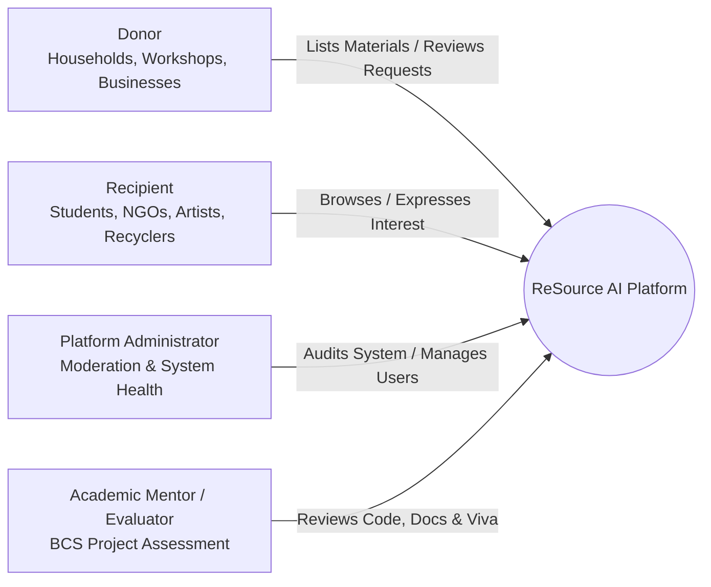

# Project Design Report (PDR)
## ReSource AI — AI-Powered Waste-to-Resource Platform

---

### 1. Title & Executive Metadata
* **Project Name:** ReSource AI (AI-Powered Waste-to-Resource Platform)
* **Author / Candidate:** Final-Year Bachelor of Computer Science (BCS) Candidate
* **Academic Guidance:** Project Mentor / Department of Computer Science
* **Date of Documentation:** October 2026
* **Version:** 1.0.0 (Milestone Release)

---

### 2. Abstract
Rapid urbanization and industrial consumption generate enormous volumes of clean, reusable solid waste—such as corrugated packaging, glass containers, hardwood offcuts, fabric scraps, and durable plastics. In traditional waste disposal systems, these items are directed to municipal landfills or incinerators because their generators lack an efficient, hyper-localized mechanism to discover potential reusers. Simultaneously, academic students, vocational schools, artisan upcyclers, non-governmental organizations (NGOs), and community recyclers actively seek affordable or free raw materials for design, prototyping, and community projects.

**ReSource AI** bridges this systemic gap by establishing an intelligent, full-stack circular economy platform. Built using modern web technologies (React, Vite, Node.js, Express, PostgreSQL) and data science methodologies (TF-IDF vectorization and cosine similarity), ReSource AI enables donors to list surplus materials with location and imagery, while recipients can browse, filter, receive explainable recommendations, and submit formal interest requests. The platform features an explainable dual-layer recommendation framework: an operational 100-point heuristic baseline model and an advanced content-based scikit-learn machine learning engine with automatic fallback resilience.

---

### 3. Problem Statement
Contemporary waste management suffers from three acute structural deficiencies:
1. **The Circularity Information Void:** Donors (households, restaurants, shipping warehouses, fabricators) routinely discard intact materials because identifying secondary beneficiaries entails prohibitive coordination costs.
2. **Resource Scarcity for Creatives and Grassroots Organizations:** Students, artists, social enterprises, and small workshops experience financial barriers when purchasing virgin materials, despite vast reserves of surplus discards existing within their immediate urban radius.
3. **Black-Box, Opaque Recommender Systems:** Modern online platforms frequently present algorithmic recommendations without explanatory context, diminishing user trust and reducing conversion rates for localized community exchanges.

---

### 4. Project Objectives
The primary engineering and research objectives of the ReSource AI project are:
* **Objective 1 — Full-Stack Marketplace Infrastructure:** Develop a secure, responsive, and performant web application allowing material donors to publish listings and recipients to search, filter, and express interest.
* **Objective 2 — Relational Persistence & Media Management:** Design an ACID-compliant PostgreSQL database schema supporting user management, listings lifecycle, interest tracking, and scoring records, supplemented by Cloudinary cloud image hosting.
* **Objective 3 — Transparent Explainable Recommendations:** Build an explainable scoring architecture that computes relevance scores using multi-attribute matching (category, location, keywords, recency) and presents explicit human-readable reasons for every match.
* **Objective 4 — Machine Learning Content-Based Enhancement:** Integrate a Python and scikit-learn microservice utilizing Term Frequency-Inverse Document Frequency (TF-IDF) and Cosine Similarity to compute semantic similarity between listing metadata and recipient profiles.
* **Objective 5 — High Availability via Defensive Degradation:** Implement an automated fallback mechanism ensuring that if the Python ML microservice becomes unavailable, the core web platform remains 100% operational using the baseline heuristic engine.
* **Objective 6 — Rigorous Software Engineering & Academic Quality:** Deliver comprehensive documentation, automated test suites, accessibility adherence (WCAG 2.1 AA), and production deployment readiness.

---

### 5. Project Scope

#### In Scope (MVP Core):
* User registration and authentication with role-based identities (`donor`, `recipient`, `admin`).
* Material listing creation, editing, status management (`available`, `reserved`, `collected`, `archived`), and image attachment.
* Public marketplace catalog with multi-facet filtering (material category, city, condition) and full-text keyword search.
* Express-interest transaction workflow enabling recipients to message donors and donors to accept or decline requests.
* Recipient preference profiling (target material categories, operational city).
* Dual-layer recommendation engine (Node.js rule-based baseline + Python scikit-learn TF-IDF engine).
* Responsive web interface optimized for mobile, tablet, and desktop viewports.
* Automated API integration testing, seed data provisioning, and complete documentation.

#### Non-Goals / Out of Scope:
* Commercial financial payment gateways or monetary transactions (all items are donated freely or bartered).
* Real-time peer-to-peer WebSocket chat (direct messaging handled via structured interest requests and email contact exchange).
* Live GPS tracking, courier routing, or integrated logistics dispatch.
* Deep neural networks, complex computer vision models, or unexplainable black-box AI.
* Mobile native applications (iOS/Android native binaries); responsive progressive web design is utilized instead.

---

### 6. Users and Stakeholders

| User Persona | Description | Primary Needs / Motivations |
| :--- | :--- | :--- |
| **Material Donor** | Households, retail outlets, carpentry shops, packaging centers with discarded items. | Declutter spaces responsibly; divert waste from landfills; track status of donated items effortlessly. |
| **Material Recipient** | University design students, non-profit organizations, upcyclers, hobbyists. | Locate free, reusable raw materials nearby; receive personalized alerts matching their creative disciplines. |
| **Administrator** | Platform maintainer and system monitor. | Monitor platform health, manage category taxonomies, review audit logs, and oversee moderation. |
| **Academic Evaluator** | Project guide, external BCS examiners, academic board. | Assess software design quality, architectural integrity, ML implementation correctness, and test coverage. |

---

### 7. Functional Requirements

* **FR-1: User Management & Authentication**
  * FR-1.1: System shall allow new users to register with name, email, password, role, city, and preferred categories.
  * FR-1.2: System shall authenticate users via email and password, issuing a signed JSON Web Token (JWT).
  * FR-1.3: System shall encrypt passwords using `bcrypt` with a minimum cost factor of 10.
  * FR-1.4: System shall allow authenticated users to fetch and update their profile details (`GET /api/auth/me`, `PATCH /api/users/me`).
* **FR-2: Listings Management**
  * FR-2.1: Donors shall create listings specifying title, category, material type, condition, quantity, description, city, and image.
  * FR-2.2: System shall validate listing inputs using schema validation before database insertion.
  * FR-2.3: System shall support image uploads through Cloudinary with fallback handling.
  * FR-2.4: Donors shall update or archive their own listings.
  * FR-2.5: System shall enforce access controls preventing non-owners from modifying listings.
* **FR-3: Browse, Search & Discovery**
  * FR-3.1: System shall render a paginated list of all active (`available`) listings.
  * FR-3.2: System shall allow filtering listings by category, city, and condition.
  * FR-3.3: System shall support text query search matching across title and description.
* **FR-4: Interest Expressions**
  * FR-4.1: Authenticated recipients shall submit interest requests with an explanatory message.
  * FR-4.2: Donors shall view all interest requests submitted for their listings.
  * FR-4.3: Donors shall accept or decline interest requests, updating request state.
* **FR-5: Recommendation System**
  * FR-5.1: System shall compute a transparent 100-point match score for active listings against recipient preferences.
  * FR-5.2: System shall provide natural-language reasoning justifying why each listing was recommended.
  * FR-5.3: System shall interface with an optional Python TF-IDF cosine-similarity microservice for content-based semantic matching.
  * FR-5.4: System shall automatically default to the baseline rule-based scorer if the Python service fails or times out.

---

### 8. Non-Functional Requirements

* **NFR-1: Performance & Latency:** API endpoints shall respond within 250 milliseconds under standard loads; recommendation queries shall execute within 400 milliseconds.
* **NFR-2: Security & Privacy:** All incoming payloads shall be sanitized and validated; passwords and sensitive keys shall never appear in logs or client-facing responses; JWT tokens shall use SHA-256 signatures with expiration policies.
* **NFR-3: Reliability & Fault Tolerance:** Failure of the Python ML microservice must not cascade to the web application. The core Express API shall maintain 99.9% uptime for core marketplace operations.
* **NFR-4: Accessibility (a11y):** The React frontend shall adhere to WCAG 2.1 Level AA standards, incorporating semantic HTML elements, visible focus states, proper color contrast ratios (>= 4.5:1), and ARIA attributes.
* **NFR-5: Maintainability & Code Quality:** Codebase shall maintain modular separation of concerns (MVC architecture on server, atomic component architecture on client), comprehensive inline documentation, and zero circular dependencies.

---

### 9. User Stories

1. *As a Carpenter/Workshop Owner (Donor),* I want to list surplus timber scraps and packaging crates with photos and dimensions so that local woodworkers or students can collect them instead of throwing them into garbage dumpsters.
2. *As an Art & Design Student (Recipient),* I want to set my preferred materials to "cardboard" and "textile" and my city to "Bengaluru" so that I instantly see matching discarded supplies for my semester installation.
3. *As a Recipient,* I want to see an explanation of why a listing was recommended to me so that I understand if it matches my specific location and project requirements.
4. *As a Donor,* I want to review received interest messages from potential collectors so that I can choose a credible recipient and mark the item as "reserved".
5. *As an Academic Reviewer,* I want to inspect clean, well-tested code with complete API documentation and a working demo script so that I can evaluate the engineering rigor of the capstone project.

---

### 10. Use Cases

#### Use Case UC-01: Post a Material Listing
* **Primary Actor:** Material Donor
* **Preconditions:** Donor is logged into an authenticated session.
* **Main Success Scenario:**
  1. Donor navigates to "Create Listing".
  2. Donor fills in listing fields: Title ("Corrugated Heavy-Duty Shipping Boxes"), Category ("cardboard"), Material Type ("Cardboard"), Condition ("Good"), Quantity ("25 boxes"), City ("Bengaluru"), Description ("Clean, flattened moving boxes").
  3. Donor selects a photo file; system uploads the image to Cloudinary and returns a secure CDN URL.
  4. Donor submits form.
  5. System validates payload, persists record in PostgreSQL, and redirects donor to the listing detail page.
* **Extensions:**
  * 3a. Cloudinary API key missing or network fails: System falls back to storing local static image placeholder gracefully.
  * 4a. Required field missing: System highlights input with descriptive validation error message.

#### Use Case UC-02: Express Interest in a Listing
* **Primary Actor:** Material Recipient
* **Preconditions:** Recipient is authenticated; listing status is `available`.
* **Main Success Scenario:**
  1. Recipient views listing detail page.
  2. Recipient clicks "Express Interest" and completes the modal form with an intended reuse message ("We are an NGO workshop conducting craft activities for children this weekend").
  3. System saves interest record with status `pending`.
  4. System notifies recipient of successful submission.
* **Extensions:**
  * 1a. Recipient is the listing owner: System disables interest button to prevent self-dealing.

---

### 11. Feasibility Analysis

* **Technical Feasibility:** The technology stack (Node.js, Express, React, PostgreSQL, Python, scikit-learn) is robust, mature, open-source, and extensively documented. Free cloud hosting tiers (Vercel, Render/Railway, Neon PostgreSQL) make deployment zero-cost for academic evaluation.
* **Operational Feasibility:** The dual-layer recommendation design guarantees that system operation does not depend on complex GPU clusters or fragile ML pipelines.
* **Economic Feasibility:** The project utilizes standard open-source libraries and public cloud free-tier allocations, incurring zero software licensing expenditure.

---

### 12. Risk Analysis & Mitigation Strategies

| Risk Description | Severity | Likelihood | Mitigation Strategy |
| :--- | :---: | :---: | :--- |
| **Python ML Microservice Downtime** | High | Medium | Defensive circuit breaker in Node.js backend: if Python request fails or times out after 1.5s, fall back seamlessly to rule-based heuristic. |
| **Third-Party Image Upload Failure** | Medium | Low | Cloudinary service module wraps upload calls in try-catch with a fallback default image URL and local storage adapter. |
| **Database Connection Latency / Outage** | High | Low | Connection pool (`pg.Pool`) configured with idle timeouts, connection limits, and reconnect handlers. |
| **Unauthorized Data Tampering** | High | Low | JWT authentication middleware with role-based access control and row-level ownership validation on listing mutations. |
| **Cold Starts on Free Cloud Providers** | Medium | Medium | Health check endpoint (`GET /api/health`) and lightweight bundle architecture minimize startup latency. |

---

### 13. Timeline & Milestone Projections

* **Milestone 1 (Phase 0 - 1):** Documentation, Architecture, Repository Initialization, Health Checks.
* **Milestone 2 (Phase 2 - 3):** PostgreSQL Database DDL, Migrations, Seed Data, Auth & Security.
* **Milestone 3 (Phase 4 - 5):** Material Listing CRUD, Image Hosting, Browse Portal, Interest Workflow.
* **Milestone 4 (Phase 6):** Recommendation Engine (Rule-Based + Python TF-IDF Cosine Matcher).
* **Milestone 5 (Phase 7):** Automated Testing, Accessibility Audit, Edge-Case Hardening.
* **Milestone 6 (Phase 8 - 9):** Production Deployment, Postman Collection, Project Viva Script, Final Handover.

---

### 14. Expected Outcomes
* A fully functional, production-ready web application facilitating waste material redirection.
* Complete academic-grade technical documentation suitable for university project presentation.
* An explainable AI implementation demonstrating practical data science integration without black-box opacity.
