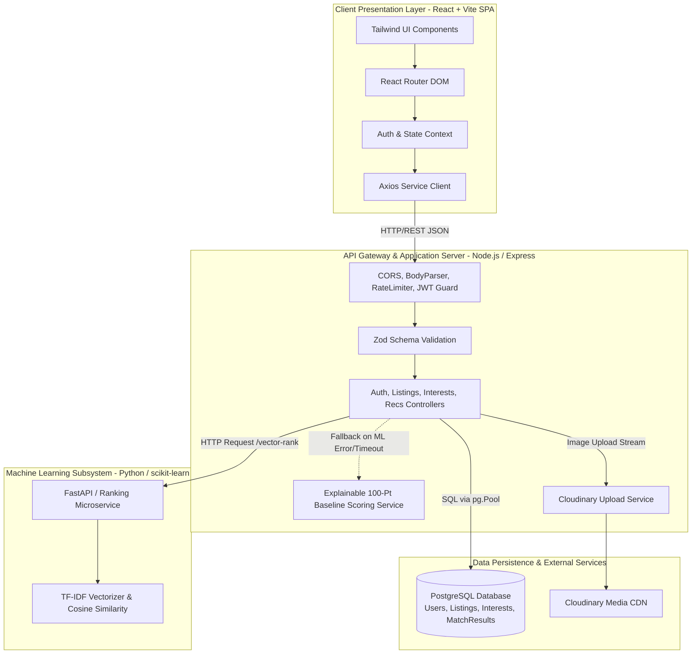
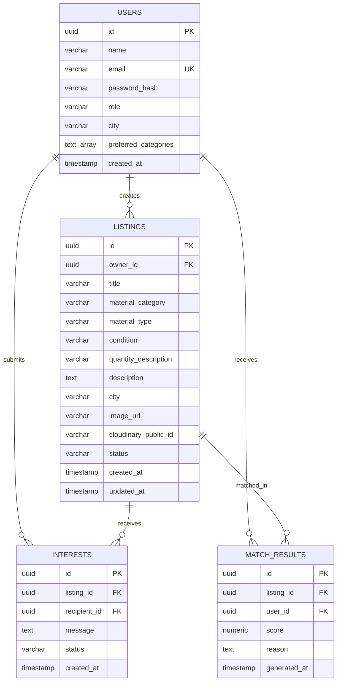
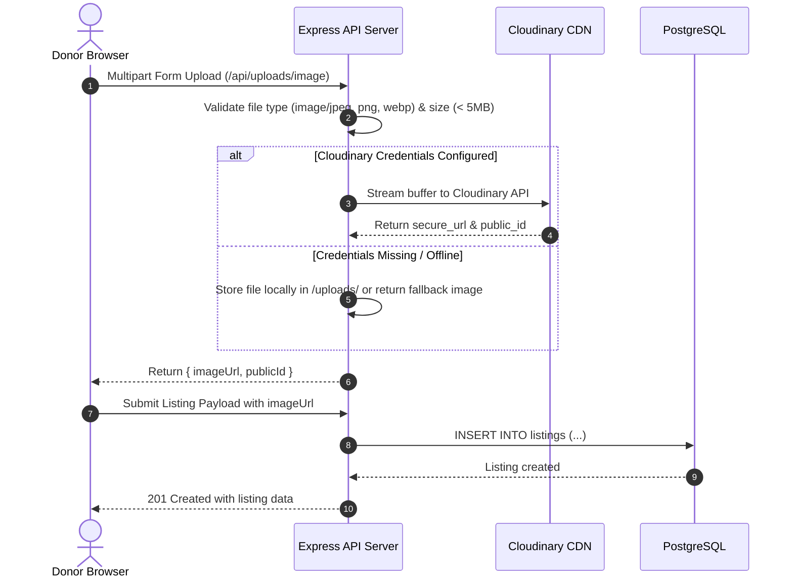

# Technical Design Report (TDR)
## GreenLoop — AI-Powered Waste-to-Resource Platform

---

### 1. Technology Stack & Technical Justifications

| Layer | Technology | Version / Tool | Technical Justification |
| :--- | :--- | :--- | :--- |
| **Frontend Framework** | React.js with Vite | React 18+, Vite 5+ | Fast Hot-Module Replacement (HMR), small production bundle size, rich ecosystem of accessible components, virtual DOM efficiency. |
| **Styling & Design** | Tailwind CSS | Tailwind v3+ | Utility-first CSS allowing rapid, cohesive design system construction; responsive breakpoints; zero runtime overhead via PurgeCSS tree-shaking. |
| **Backend Framework** | Node.js with Express.js | Node 18+, Express 4+ | Non-blocking event-driven I/O ideal for RESTful API orchestration, unified JavaScript across stack, vast NPM library ecosystem. |
| **Relational Database** | PostgreSQL | PostgreSQL 14+ | ACID compliance, robust indexing (B-Tree, Full-Text GIN if needed), native JSON/array support for user preference arrays, high reliability. |
| **Database Client** | `pg` (node-postgres) | v8.11+ | Lean, native PostgreSQL driver without heavy ORM overhead, offering transparent query control, deterministic migrations, and connection pooling. |
| **Authentication** | JWT & `bcryptjs` | JWT (`jsonwebtoken`), `bcryptjs` | Stateless authentication scalable across cloud containers; secure one-way salted password hashing (10 rounds). |
| **Request Validation** | Zod | v3.22+ | Type-safe declarative schema validation at the HTTP boundary, producing descriptive error messages for invalid user inputs. |
| **Media Storage** | Cloudinary CDN + Local Fallback | Cloudinary SDK | Cloud-based media optimization, auto-format/resizing, instant CDN delivery; local storage adapter prevents blocking development offline. |
| **ML & Data Science** | Python, scikit-learn, pandas | Python 3.9+, scikit-learn 1.3+ | Industry-standard vectorization (`TfidfVectorizer`) and mathematical distance computation (`cosine_similarity`). |
| **API Testing & Spec**| Postman, Supertest, Jest | Postman v10+, Supertest 6+ | Automated endpoint verification, status code checks, schema contract regression testing. |

---

### 2. High-Level System Architecture

---

### 3. Frontend Architecture & Design

* **Directory Organization:**
  * `client/src/api/`: Axios interceptors injecting JWT `Bearer` tokens into HTTP Authorization headers.
  * `client/src/components/`: Modular UI widgets (Navbar, Footer, ListingCard, FilterBar, Modal, Alert, Badge).
  * `client/src/context/`: `AuthContext` managing token storage in `localStorage`, user session deserialization, login, and logout.
  * `client/src/pages/`: Atomic screen views (Home, BrowseListings, ListingDetail, CreateListing, EditListing, DonorDashboard, Recommendations, Login, Register).
  * `client/src/routes/`: Declarative route definitions with `<ProtectedRoute>` higher-order wrappers.
* **Responsive Breakpoints & Design Tokens:**
  * Mobile-first responsive grid (`grid-cols-1 md:grid-cols-2 lg:grid-cols-3 xl:grid-cols-4`).
  * Accessible color palette: Emerald (`#059669`) for sustainability, Slate (`#0f172a`) for readability, Amber (`#d97706`) for notifications.
  * Micro-interactions: Tailwind transitions, hover elevations, keyboard outline rings (`focus:ring-2 focus:ring-emerald-500`).

---

### 4. Backend Architecture & Design

* **Architectural Pattern:** Layered Model-Controller-Service-Route pattern with clear separation of concerns.
* **Core Modules:**
  * `server/src/server.js`: Entry point binding HTTP listener and graceful shutdown hooks (`SIGTERM`, `SIGINT`).
  * `server/src/app.js`: Express application instance, CORS configuration, security headers, JSON parser, request logger, route mountings, and centralized error handler.
  * `server/src/controllers/`: Handlers for business logic, status codes, and HTTP responses.
  * `server/src/services/`: Abstracted business workflows (Cloudinary client, rule-based recommendation scorer, Python matcher proxy).
  * `server/src/middleware/`: Auth verification (`verifyToken`), role checkers (`requireRole`), and global error middleware (`errorHandler`).

---

### 5. Database Design & Entity Relationship (ER) Model

#### Indexing Strategy:
1. `listings_status_idx`: B-Tree index on `listings(status)` to accelerate public catalog queries.
2. `listings_city_category_idx`: Compound B-Tree index on `listings(city, material_category)` for fast multi-filter browse queries.
3. `interests_recipient_idx`: B-Tree index on `interests(recipient_id)` and `interests(listing_id)` for swift dashboard retrieval.
4. `users_email_idx`: Unique index on `users(email)` guaranteeing fast auth lookups.

---

### 6. REST API Design & Contracts

| Method | Endpoint | Access | Purpose |
| :--- | :--- | :--- | :--- |
| `POST` | `/api/auth/register` | Public | Register new user account with role and preferences |
| `POST` | `/api/auth/login` | Public | Authenticate user credentials and return JWT token |
| `GET` | `/api/auth/me` | Authenticated | Retrieve profile details of currently logged-in user |
| `PATCH`| `/api/users/me` | Authenticated | Update user profile, city, and preferred categories |
| `GET` | `/api/listings` | Public | Query active listings with search, category, city filters |
| `POST` | `/api/listings` | Authenticated (Donor/Admin) | Create a new material listing with image URL |
| `GET` | `/api/listings/:id` | Public | Retrieve single listing details and donor profile |
| `PATCH`| `/api/listings/:id` | Authenticated (Owner) | Modify listing details or status |
| `DELETE`| `/api/listings/:id`| Authenticated (Owner/Admin) | Delete or archive listing |
| `POST` | `/api/uploads/image`| Authenticated | Upload listing image to Cloudinary / storage |
| `POST` | `/api/listings/:id/interests` | Authenticated (Recipient) | Submit interest request for an available item |
| `GET` | `/api/listings/:id/interests` | Authenticated (Owner) | Retrieve interest requests for a specific listing |
| `GET` | `/api/users/me/interests` | Authenticated | Retrieve interest requests sent/received by user |
| `PATCH`| `/api/interests/:id/status` | Authenticated (Owner) | Update interest status (`accepted`, `declined`) |
| `GET` | `/api/recommendations` | Authenticated (Recipient) | Fetch ranked listing recommendations with reasons |
| `GET` | `/api/health` | Public | System uptime, database connectivity health check |

---

### 7. Authentication & Security Design

1. **Password Hashing:** Passwords hashed with `bcryptjs` utilizing salt generation: `hash = bcrypt.hashSync(password, 10)`. Plaintext passwords are never logged or stored.
2. **Stateless JWTs:** User payload `{ id, email, role }` signed using `HS256` with environment secret `JWT_SECRET` and standard 7-day expiration.
3. **Middleware Authorization Guard:**
   * Token extracted from `Authorization: Bearer <token>`.
   * Invalid or expired tokens return `401 Unauthorized`.
   * Mutation attempts on listings owned by another user return `403 Forbidden`.
4. **Input Sanitization & Validation:** Zod schemas reject malformed email strings, short passwords (< 6 chars), and empty titles before SQL query execution.

---

### 8. Cloudinary Image Storage Integration

---

### 9. Recommendation System Architecture

#### Layer 1: Baseline Explainable Rule-Based Scorer (Mandatory)
The baseline algorithm scores each active listing $L$ against recipient preference profile $U$:

$$\text{Score}(L, U) = S_{\text{cat}} + S_{\text{city}} + S_{\text{kw}} + S_{\text{rec}}$$

Where:
* **Category Match ($S_{\text{cat}}$) = 40 points:** Assigned if $L.\text{category} \in U.\text{preferred\_categories}$.
* **City Match ($S_{\text{city}}$) = 25 points:** Assigned if $L.\text{city} = U.\text{city}$ (case-insensitive).
* **Keyword Match ($S_{\text{kw}}$) = 20 points:** Assigned if any recipient keyword or preferred category occurs in $L.\text{title}$ or $L.\text{description}$.
* **Recency Score ($S_{\text{rec}}$) = 15 points:**
  * Listed $\le 3$ days ago: 15 points
  * Listed $\le 7$ days ago: 10 points
  * Listed $\le 14$ days ago: 5 points
  * Older: 0 points

* **Explainability Generation:** A deterministic template generates human-readable explanations such as:
  > *"Recommended (Score: 80/100) because it matches your preferred category 'cardboard', is available locally in Bengaluru, and was posted recently."*

#### Layer 2: Python / scikit-learn Content-Based Filtering (Enhancement)
* **Document Formulation:** Each listing is converted into a concatenated document:
  $$D_L = \text{title} \oplus \text{category} \oplus \text{material\_type} \oplus \text{condition} \oplus \text{description} \oplus \text{city}$$
* **Recipient Query Document:** The recipient profile is formulated into a preference document:
  $$D_U = \bigcup \text{preferred\_categories} \oplus \text{city} \oplus \text{interest\_history}$$
* **Vectorization:** `TfidfVectorizer(stop_words='english', max_features=1000)` converts text into normalized TF-IDF term vectors $\vec{V}_L$ and $\vec{V}_U$.
* **Cosine Similarity:**
  $$\text{CosineSimilarity}(\vec{V}_L, \vec{V}_U) = \frac{\vec{V}_L \cdot \vec{V}_U}{\|\vec{V}_L\| \|\vec{V}_U\|}$$
* **Blended Score:** Normalized to a 100-point scale.
* **Fault-Tolerant Microservice Bridge:** Node.js sends an asynchronous HTTP request with a 1500ms timeout to `http://localhost:8000/rank`. If an error, timeout, or non-200 code occurs, the rule-based scorer immediately handles the request without failing the user.

---

### 10. Testing Strategy

1. **Unit Testing:** Pure utility functions (score calculation, text vectorization, date formatters, validation schemas).
2. **Integration Testing:** Supertest suites executing HTTP requests against an Express test instance and test database, verifying:
   * Registration -> Login -> Token verification.
   * Listing creation -> Read -> Ownership update -> Unauthorized delete attempt.
   * Recommendation generation with populated preferences.
3. **Accessibility Audits:** Manual keyboard tab-order verification, screen reader testing, and automated HTML/ARIA linting.

---

### 11. Deployment Architecture

* **Frontend:** Deployed as a static SPA on **Vercel** with global CDN edge caching.
* **Backend:** Deployed as a web service container on **Render** or **Railway**.
* **Database:** Managed serverless PostgreSQL on **Neon** or **Supabase** with SSL enforcement (`ssl: { rejectUnauthorized: false }`).
* **Python Matcher:** Deployed on Render/Railway as an independent web service or bundled locally.

---

### 12. Limitations & Future Roadmap

* **Current Limitations:**
  * Recommendations rely on content-based filtering without collaborative filtering (since cold-start platforms lack historic collaborative purchase/rating data).
  * Communications are asynchronous interest requests rather than instant real-time chats.
* **Future Roadmap:**
  * Add automated carbon-offset savings estimation (kg CO₂ diverted from landfills per material type and weight).
  * Introduce geolocation radius distance calculation using PostGIS.
  * Integrate multi-language UI localization (Hindi, Kannada, Tamil, Marathi) for diverse community adoption.
